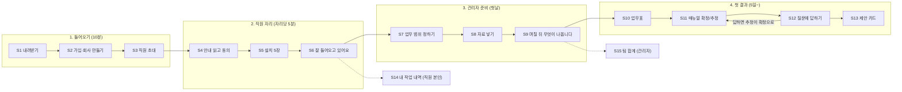

# 설치부터 첫 결과까지 — 화면 흐름 설계

기준일 2026-11-14 · **설계만 한다(만들지 않는다).** 화면 번호 S1~S15는 패키징 자료(`NOWLINK_패키징/07_다음_할일.md`)와 같은 번호를 쓴다.
기준(사장님): "내려받아 설치하고 쓰면 원하는 결과가 나와야 솔루션이다." 모양·버튼은 [`UI_STANDARD.md`](UI_STANDARD.md)를 따른다.

## 한 장 그림

막히는 곳마다 **이유 + 다음 한 걸음**을 그 자리에서 보여 준다(되돌아갈 곳을 항상 둔다).

## 화면별 설계 (한 화면 = 한 가지 일, 주 버튼 1개)

| 번호 | 화면 | 3초 안에 알아야 할 것(제목) | 주 버튼 | 보조 | 비었을 때·막혔을 때 | 지금 |
|---|---|---|---|---|---|---|
| S1 | 내려받기 | "설치 파일 받기" | 설치 파일 받기 | 설치 전에 읽을 것 | 받기가 막히면 이유(보안 프로그램 등)와 푸는 법 | 있음 |
| S2 | 가입·회사 만들기 | "회사 이름만 넣으면 시작합니다" | 회사 만들기 | 이미 있는 회사에 들어가기 | 칸 아래에 무엇이 틀렸는지 | 있음(품질 미검증) |
| S3 | 직원 초대 | "함께 쓸 자리를 고릅니다" | 초대 주소 복사하기 | 나중에 하기 | 초대 0명이면 "먼저 내 자리부터" 안내 | 미검증 |
| S4 | 안내 읽고 동의 | "무엇을 모으고 무엇을 안 모으는지" | 동의하고 계속하기 | 동의하지 않기(설치 안 함) | 동의하지 않아도 불이익 없음을 적는다 | 있음 |
| S5 | 설치 5장 | 단계 표시(환영·동의·코드·준비·완료) | 다음 → 마지막 장은 "설치 끝내기" | 이전 | 준비 단계에서 걸리면 걸린 항목과 푸는 법 | 있음 |
| S6 | 잘 들어오고 있어요 | "이 자리의 업무 기록이 들어오고 있습니다" + 자리별 초록/노랑/빨강 꼬리표(글과 함께) | 업무 범위 정하러 가기 | 내 작업 내역 보기 | 10분 넘게 안 들어오면 원인 후보 3가지와 "다시 확인하기" | **없음** |
| S7 | 업무 범위 정하기 | "업무에 쓰는 것만 고릅니다" — 며칠 본 후보를 카드로 | 이 범위로 정하기 | 직접 더하기 | 후보가 아직 없으면 "내일 다시 보입니다" + 직접 더하기 | **없음** |
| S8 | 자료 넣기 | "전산에서 내보낸 파일을 올립니다" — 올릴 수 있는 형식·크기를 미리 | 파일 올리기 | 건너뛰기(나중에) | 읽지 못한 파일은 줄별로 이유 | **없음** |
| S9 | 며칠 뒤 무엇이 나옵니다 | 날짜 줄: 1시간·5일·10일·15일·20일에 화면에 나올 것 | 지금 나온 것 보기 | 알림 받기 | 늦어지면 늦어진 이유와 새 날짜 | **없음** |
| S10 | 업무표 | "오늘 할 일" — 하루·주·월·요일 | (줄마다) 매뉴얼 열기 | 문제가 생겼을 때 | 아직 없으면 S9로 돌려보내는 빈 화면 | 제품 안에 없음(네노바웹 `/work/manuals`가 본보기) |
| S11 | 매뉴얼 확정/추정 | 단계 번호 + 화면 캡처 + 확정/추정 꼬리표 | 확인 완료로 바꾸기 | 고치기 | 추정이면 "무엇을 답하면 확정되는지" 연결 | 제품 안에 없음(본보기 있음) |
| S12 | 질문에 답하기 | "보기 중에 고르면 됩니다" — 한 번에 한 질문 | 이 답으로 정하기 | 모르겠어요 · 다음 질문 | 질문 0개면 "다 풀렸습니다" | **없음** |
| S13 | 제안 카드 | 제목 + 한 줄 + 아끼는 시간(가설 표시) | 써 보기 | 나중에 | 제안이 없으면 화면에 자리를 차지하지 않는다 | **없음**(네노바웹에서 첫 시험 중) |
| S14 | 내 작업 내역 | "내 것만 보입니다" | 내려받기 | 모으기 멈추기 | 내역 0건이면 이유 | 있음 |
| S15 | 팀 합계 | 팀 단위 숫자(개인 줄 없음) | — (읽는 화면) | 기간 바꾸기 | 자료가 모자라면 "며칠 더 필요" | 미검증 |

## 지금 없는 화면 (만들 차례)

1. **S6 잘 들어오고 있어요** — 설치의 끝을 "완료" 글자가 아니라 "들어오고 있음" 확인으로 바꾼다. 재는 통로는 서버에 있다.
2. **S9 며칠 뒤 무엇이 나옵니다** — 기다리는 동안 무엇을 기다리는지 보여 준다. 이것이 없으면 5일 동안 빈 화면이다.
3. **S7 업무 범위 정하기**
4. **S8 자료 넣기**
5. **S12 질문에 답하기**
6. **S13 제안 카드**(네노바웹 시험 결과를 본 뒤)
7. S10·S11은 네노바웹 화면을 제품 안으로 옮기는 일(새 설계가 아니라 이식).

우선순위 근거: S6·S9가 없으면 "설치했는데 아무 일도 안 일어난다"가 된다 — 설치 직후 떠나는 것을 막는 두 화면이 먼저다(가설: 다른 회사에서 재 본 적 없음).

## 공통 규칙

- 단계가 있는 흐름(S5)은 탭이 아니라 **단계 표시** + 이전/다음. 마지막 "다음"은 실제 행동 이름으로.
- 긴 첫 설명을 띄우지 않는다. 그 자리의 한 줄 도움말로.
- 직원이 보는 문구는 "업무 기록", "내 작업 내역". 감시·추적을 떠올리는 낱말을 쓰지 않는다.
- 관리자 화면의 기본은 팀 합계. 개인 화면은 본인만.
- 기다림: 1초 미만은 표시 없음, 1~3초 돌림 표시, 그 이상은 진행 줄과 "지금 하는 일" 이름.

## 약점

- 이 흐름은 네노바 한 곳의 경험으로 그렸다. 다른 회사의 설치에서 어디서 막히는지는 재 본 적이 없다(가설).
- S9의 날짜(1시간·5일·10일·15일·20일)는 패키징 자료의 계획값이며 실측이 아니다.
- 측정 방법: 화면마다 "들어온 사람 수 → 주 버튼을 누른 사람 수"를 세면 어디서 떠나는지 보인다. 그 숫자를 남기는 장치는 아직 없다.
