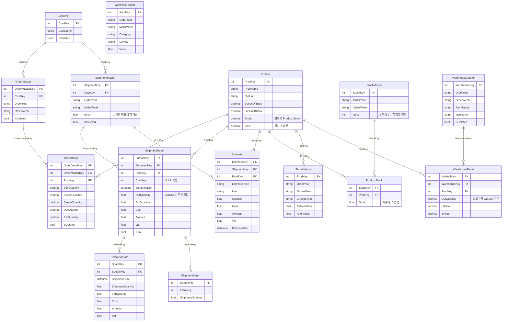

# 핵심 테이블 ERD · 정본(SSOT) · 쓰기 트랜잭션 경계

작성 2026-11-21 · 코드와 문서만 읽고 작성(DB 접속·운영 서버·ECOUNT 접근 없음). 근거는 `경로:줄` 형식이며 기준 커밋은 `origin/master c2a0ceb3`.

## (가) 목적

1. 주문·분배·출고·재고·매출원가 테이블이 서로 어떻게 이어지고 어느 테이블이 정본인지를 한 장으로 보여 준다(nenova.exe와 같은 DB를 쓰므로 웹 코드가 건드리는 범위만 기록).
2. 한 번에 여러 테이블을 쓰는 API가 트랜잭션으로 묶여 있는지 구분해, 중간에 끊겨 숫자가 어긋날 수 있는 곳을 미리 찾는다.

범례: `코드 미확인` = 이 저장소 코드·문서에서 근거를 못 찾은 항목(추정으로 적지 않음). 관계선은 코드의 JOIN/키 사용으로 보이는 논리 관계이며 DB의 FK 제약 선언 여부는 확인하지 못했다.

## (나) ERD

`WebProfitReport`는 ProdKey가 없는 웹 전용 (연도·대차수·카테고리·열) 키-값 원장이라 위 그림에서 관계선 없이 단독으로 둔다. 값은 `ProductStock`·`ShipmentDetail` 등을 읽어 계산한 결과를 저장하는 구조로 보이나 정확한 코드 경로(`lib/profitReport.js`)는 줄 단위로 확인하지 못했다.

## (다) 테이블별 정리

| 테이블 | 용도 | 정본(SSOT) 여부 | 쓰는 코드 경로 | 읽기전용 여부 |
|---|---|---|---|---|
| Customer | 거래처 마스터 | 정본(전산 마스터) | 웹은 조회 위주(쓰기 경로 미조사) | 웹 주문·출고 경로에서는 읽기 |
| Product | 품목 마스터 + 현재고 `Stock` | 마스터는 정본. `Product.Stock`은 "현재고" 정본이며 `ProductStock`과 다른 축((마)절 참고) | `pages/api/stock/index.js:258`, `pages/api/stock/adjust-batch.js:143`, `lib/invoiceReceiptNative.js:86`, `pages/api/shipment/fix.js:944` | 마스터 컬럼은 읽기, `Stock`만 갱신 |
| OrderMaster | 주문 헤더(차수·업체) | 정본 | `pages/api/orders/index.js:569`, `pages/api/shipment/adjust.js:743`, `pages/api/public/orders.js:278`, `pages/api/m/order-request-approve.js:103` | 쓰기 |
| OrderDetail | 주문 라인(박스·단·송이 환산 3종) | 정본 | `pages/api/orders/index.js:826,880,942`, `pages/api/shipment/adjust.js:801,844` | 쓰기 |
| ShipmentMaster | 출고 헤더, `isFix`=확정 | 정본(확정 여부의 정본). `isFix` 변경은 전산 SP `usp_ShipmentFix` 경유 | 생성: `pages/api/shipment/distribute.js:827`, `pages/api/orders/index.js:624`; 확정: `pages/api/shipment/fix.js:1057` | 웹은 생성만, 확정은 SP 호출 |
| ShipmentDetail | 분배·출고 라인(`OutQuantity` 단일값, `Cost/Amount/Vat`) | 정본(분배 수량·매출금액) | `pages/api/shipment/distribute.js:874,900`, `pages/api/shipment/adjust.js:1016,1043`, `pages/api/estimate/update-quantity.js:214` | 쓰기 |
| ShipmentDate | 출고일별 분할 수량·견적수량 | 파생에 가까움(합계는 `ShipmentDetail.OutQuantity`와 같아야 함, `lib/syncShipmentDateEst.js:1-2`) | `lib/shipmentDistributionDates.js:113`, `lib/syncShipmentDateEst.js:58`, `pages/api/shipment/distribute.js:860` | 쓰기 |
| ShipmentFarm | 출고 행의 농장별 배분 | 정본(농장 배분) | `pages/api/shipment/adjust.js:455-460` | 쓰기 |
| Estimate | 견적서 행(`Cost/Amount/Vat`, 불량 차감은 음수) | 견적 정본 | `pages/api/estimate/index.js:1007`, `pages/api/estimate/update-quantity.js:73` | 쓰기 |
| StockMaster | 재고 스냅샷 헤더(연도·차수·`isFix`) | 정본이나 웹이 직접 쓰는 경로는 코드 미확인(SP `usp_StockCalculation`이 생성·갱신으로 보임) | 읽기: `lib/chat/handlers/stock.js:642` | 웹은 읽기 |
| ProductStock | 차수별 품목 재고 스냅샷 | 차수 재고 정본이지만 전산 SP가 만든 파생값 | 쓰기는 SP만: `lib/orderStockCalculation.js`, `pages/api/warehouse/index.js:357`, `pages/api/shipment/fix.js:659` | 웹은 읽기(직접 쓰기 코드 미확인) |
| StockHistory | 재고 조정 이력(조정 입력이 재고 계산에 반영) | 정본(조정 입력) | `pages/api/stock/index.js:236`, `pages/api/stock/adjust-batch.js:125`, `pages/api/shipment/fix.js:928` | 쓰기 |
| WarehouseMaster | 입고(인보이스) 헤더 | 정본 | `pages/api/warehouse/index.js:191,292` | 쓰기 |
| WarehouseDetail | 입고 라인(`OutQuantity`, 단가) | 정본(입고 수량) | `lib/invoiceReceiptNative.js`(`insertInvoiceWarehouseDetail`), `pages/api/warehouse/index.js:232` | 쓰기 |
| WebProfitReport | 주차별 매출이익보고서 웹 전용 키-값 원장 | 웹 보고서 입력값 정본, 전산 원장에는 자동 반영 안 함 | 스키마 `docs/migrations/2026-08-10_web_profit_report_schema.sql:5`, 확정 `lib/profitReportConfirm.js:45` | 웹 전용 쓰기 |

### 업무 규칙과 테이블 연결

- 차수 = 수요일 시작~화요일 종료, 전반(seq 1)=수·목·금, 후반(seq 2)=토·일·월·화(`lib/orderWeekDate.js:3-6`). 출고일 계산은 시작일과 같거나 바로 앞 수요일 기준(`CLAUDE.md:49-55`). 연결 테이블: `OrderMaster.OrderWeek`, `ShipmentMaster.OrderWeek`, `StockMaster.OrderWeek`, `ShipmentDetail.ShipmentDtm`, `ShipmentDate.ShipmentDtm`.
- 이전 차수 마감재고 = 다음 차수 시작재고: 조회 쿼리가 `ProductStock`에서 `sm.OrderWeek < @week` 중 가장 최근 차수의 `Stock`을 이전 재고로 읽는다(`lib/chat/handlers/stock.js:638-646`). 시작재고 입력은 `StockMaster.isFix=2` 마커(`docs/DB_STRUCTURE.md` 1.4절). `StockMaster.isFix=1`은 마감 표시이며 일반 재고 화면은 이것으로 거르지 않는다(같은 문서). 연결 테이블: `StockMaster`, `ProductStock`.
- 재고 선입선출(FIFO): 수량 차감 로직은 이 조사에서 코드 미확인. 재고평가·FIFO는 도착원가 가중평균 계산(`lib/pivotArrivalCalc.js:90,107`)과 `WebStockPriceEvidence`(차수·품목별 단가 증거, `docs/DB_STRUCTURE.md` 1.5절)에서만 확인했고 이는 금액 평가용이다. 연결 테이블: `WarehouseDetail`, `ProductStock`, `WebProfitReport`.
- 매출은 `ShipmentMaster.isFix=1`만 집계(`docs/DB_STRUCTURE.md` 0절 6번). 연결 테이블: `ShipmentMaster`, `ShipmentDetail`.
- `OrderDetail`은 박스·단·송이 3종 모두 저장하고 표시는 `Product.OutUnit`으로 하나만 선택, `ShipmentDetail.OutQuantity`는 이미 단일값이라 재환산 금지(`docs/DB_STRUCTURE.md` 0절 2·3·9번, `pages/api/shipment/distribute.js:900-912`).
- 모든 조회에 `ISNULL(isDeleted,0)=0`. 단 `ShipmentDetail`·`WarehouseDetail`에는 `isDeleted` 컬럼이 없다(`docs/DB_STRUCTURE.md` 1.2·1.4절).
- 매출원가: 단일한 "매출원가" 테이블은 코드 미확인. 원가 값은 `ShipmentDetail.Cost`, `ShipmentDate.Cost`, `Estimate.Cost`, `Product.Cost`(스냅샷), 입고 단가 `WarehouseDetail.UPrice`, 웹 보고서 `WebProfitReport`/`WebStockPriceEvidence`에 나뉘어 있어 원가의 단일 정본이 코드로는 드러나지 않는다(사장님 확인 필요).

## (라) 쓰기 트랜잭션 경계

공통 도구: `lib/db.js:80`의 `withTransaction`(deadlock 시 전체 재시도, 실패하면 롤백). 아래 "한 트랜잭션"은 모두 이것을 쓴 경우다.

### 한 트랜잭션으로 묶인 곳

| API | 한 번에 쓰는 테이블 | 근거 |
|---|---|---|
| POST 분배 저장 `/api/shipment/distribute` | ShipmentMaster(없으면 생성), ShipmentDetail(삭제·수정·삽입), ShipmentDate, KeyNumbering, ShipmentHistory | `pages/api/shipment/distribute.js:793`(일괄 저장 `:995`) |
| 출고 조정 `/api/shipment/adjust` | OrderMaster, OrderDetail, ShipmentMaster, ShipmentDetail, ShipmentFarm, ShipmentAdjustment, OrderHistory, ShipmentHistory | `pages/api/shipment/adjust.js:1267`(`executeShipmentAdjustmentInTransaction`) |
| 주문 생성·수정 본체 `/api/orders` | OrderMaster, OrderDetail, ShipmentMaster, OrderHistory | `pages/api/orders/index.js:501`, `:1059` |
| 재고 조정 `/api/stock` | StockHistory, Product.Stock, `usp_StockCalculation` 연쇄 재계산 + 읽기 검증 | `pages/api/stock/index.js:221-263`, `lib/stockCascade.js:7-15` |
| 재고 일괄 조정 | 위와 동일(건별) | `pages/api/stock/adjust-batch.js:82-143` |
| 입고 등록·삭제 | WarehouseMaster, WarehouseDetail, Product.Stock, `usp_StockCalculation` | `pages/api/warehouse/index.js:153`, `:279`, `lib/invoiceReceiptNative.js:55,86` |
| 공개 주문 API, 모바일 발주 승인 | OrderMaster, OrderDetail, `usp_StockCalculation`, OrderRequest 상태 | `pages/api/public/orders.js:246,367`, `pages/api/m/order-request-approve.js:72,181-186` |
| 견적 수량 수정 | Estimate, ShipmentDetail, ShipmentHistory | `pages/api/estimate/update-quantity.js:38` |
| 확정용 재고 자동 보충 | StockHistory, Product.Stock, 재고 재계산 | `pages/api/shipment/fix.js:917` |

### 위험: 트랜잭션이 갈라지거나 없는 곳

1. **주문 저장 후 재고 재계산이 별도 트랜잭션** — `/api/orders` 생성은 `withTransaction`(`orders/index.js:501`) 커밋 뒤에 `runStockCalculation`(`:1008-1011`, `:1141`, `:1151-1164`)을 따로 실행한다. 재계산이 실패하면 `appLog`만 남기고 "재고 재계산 경고"로 성공 응답이 나가, 주문은 저장됐는데 `ProductStock` 스냅샷은 이전 값인 상태가 가능하다. (같은 목적의 `public/orders.js`·`order-request-approve.js`·`warehouse`는 재계산을 같은 트랜잭션에 넣어 대조적이다.)
2. **출고 확정이 SP 단위·카테고리 반복 + 사후 재고 계산이 별도 연결** — `usp_ShipmentFix`를 CountryFlower별로 반복 호출(`fix.js:1046-1057`)하고 그 뒤 `usp_StockCalculation`을 `queryWithDeadlockRetry`로 따로 실행한다(`fix.js:656-697`). 카테고리 일부만 확정되는 중간 상태는 `evaluatePartialCategoryFixBlock`(`fix.js:893`)으로 사전 차단하지만, SP 내부 트랜잭션 범위와 SP 성공 후 재계산 실패 시 복구는 SP 본문이 저장소에 없어 코드 미확인. 복구용 `pages/api/shipment/fix-reconcile.js`가 별도로 있다.
3. **분배 저장은 재고를 재계산하지 않음 + 이력 INSERT 실패 무시** — `distribute.js`에는 `usp_StockCalculation` 호출이 없다(재고 반영 시점은 확정 또는 전산 쪽, 코드 미확인). 또 `ShipmentHistory` INSERT는 `try/catch`로 실패를 `console.warn`만 하고 넘어가(`distribute.js:1223-1245`), 트랜잭션 안에서도 변경 이력이 빠질 수 있다.
4. (참고) `lib/syncShipmentDateEst.js`, `lib/shipmentDistributionDates.js`, `lib/weekdayDistributionApply.js` 등은 `withTransaction`을 직접 호출하지 않고 호출자가 넘긴 `tQ`로 쓴다. 호출 경로(`distribute.js`, `adjust.js`, `estimate/update-quantity.js`, `public/shipments.js`)는 트랜잭션 안이지만, `pages/api/shipment/estimate-period-repair.js`·`stock-status.js`의 모든 호출 지점이 트랜잭션 안인지는 줄 단위로 확인하지 못했다.

## (마) 두 개의 "재고" 축 (SSOT 주의)

- `Product.Stock`: 실시간 현재고. 웹 재고조정·입고·확정 보충이 직접 갱신(`stock/index.js:258`, `invoiceReceiptNative.js:86`, `fix.js:944`). `usp_StockCalculation`은 이 값을 바꾸지 않는다는 것이 코드 주석 근거(`fix.js:942`, `stock/index.js:253-256`).
- `ProductStock`(+`StockMaster`): 차수별 스냅샷. `usp_StockCalculation`이 만든다. 차수 간 이월(이전 차수 마감 → 다음 차수 시작)은 이 축.
- 두 값이 어긋날 수 있다는 진단 코드가 있다: `pages/api/shipment/stock-diag.js:3-13`(cascade 누락으로 `ProductStock`이 stale).

## (바) 근거 파일:줄과 미검증

### 근거 파일:줄

- 스키마·불변 규칙: `docs/DB_STRUCTURE.md`(0절 절대 원칙, 1.1~1.6, 2절 관계도, 3절 트리거), `CLAUDE.md:40-55`
- 차수·출고일: `lib/orderWeekDate.js:1-45`, `pages/api/shipment/distribute.js:136`
- 트랜잭션 도구: `lib/db.js:80-120`, `lib/stockCascade.js:7-15`
- 주문: `pages/api/orders/index.js:501,528,569,624,826,880,942,1008,1059,1141,1151-1164`
- 분배: `pages/api/shipment/distribute.js:793,827,860-861,874,900,995,1223-1245`, `lib/shipmentDistributionDates.js:105-125`, `lib/syncShipmentDateEst.js:58-112`
- 출고 조정·농장: `pages/api/shipment/adjust.js:455-473,743,801,1016,1043,1189,1267`
- 확정: `pages/api/shipment/fix.js:625-697,893,917-944,1046-1057`
- 재고: `pages/api/stock/index.js:221-263`, `pages/api/stock/adjust-batch.js:82-143`, `lib/chat/handlers/stock.js:638-646`, `lib/orderStockCalculation.js`, `pages/api/shipment/stock-diag.js:3-13`
- 입고: `pages/api/warehouse/index.js:153-232,279-292,335-380`, `lib/invoiceReceiptNative.js:39,55,86`
- 견적·원가: `pages/api/estimate/index.js:965,1007`, `pages/api/estimate/update-quantity.js:38,73,214`, `lib/pivotArrivalCalc.js:90,107`
- 웹 보고서: `docs/migrations/2026-08-10_web_profit_report_schema.sql:5-14`, `lib/profitReportConfirm.js:45-75`
- 공개/모바일 주문: `pages/api/public/orders.js:246,367`, `pages/api/m/order-request-approve.js:72,181`

### 미검증

- Mermaid 렌더: 설치 없이 렌더할 방법이 없고 새 의존성 추가도 금지라 **렌더 미검증**. 문법은 `erDiagram` 규칙(엔티티 블록, `타입 이름 [PK|FK] "주석"`, 관계 `||--o{ : "라벨"`)을 눈으로만 점검했다.
- 컬럼 목록은 코드에서 확인된 것만 적었고 각 테이블의 전체 컬럼이 아니다. `ShipmentDetail.isFix`, `StockMaster.isFix`의 정확한 데이터형은 환경에 따라 다르다(`docs/DB_STRUCTURE.md` 1.4절 tinyint 언급).
- FK 제약 선언 여부(특히 `ShipmentDetail`와 `OrderDetail` 사이, `Estimate.ShipmentKey`)는 코드 미확인. 주문과 출고는 같은 업체·차수·품목으로 이어지는 것으로 보이나 키 컬럼 직접 연결은 확인하지 못했다.
- `usp_ShipmentFix`, `usp_ShipmentFixCancel`, `usp_StockCalculation`, `usp_DistributeOne/Total` 본문(내부 트랜잭션·선입선출 차감 방식)은 저장소에 없어 코드 미확인.
- `Estimate.CustKey` 존재 여부: 삽입문(`estimate/index.js:1007`)에는 없고 `docs/DB_STRUCTURE.md`에는 있어 불일치(코드 미확인).
- 재고 FIFO 차감 로직, 매출원가의 단일 정본 여부, `WebProfitReport`가 값을 채우는 정확한 코드 경로(`lib/profitReport.js`)는 줄 단위 미검증.
- `estimate-period-repair.js`·`stock-status.js`·`public/shipments.js`의 쓰기 호출 전부가 트랜잭션 안인지는 미검증.
- 실제 DB 대조(INFORMATION_SCHEMA)는 하지 않았다.
