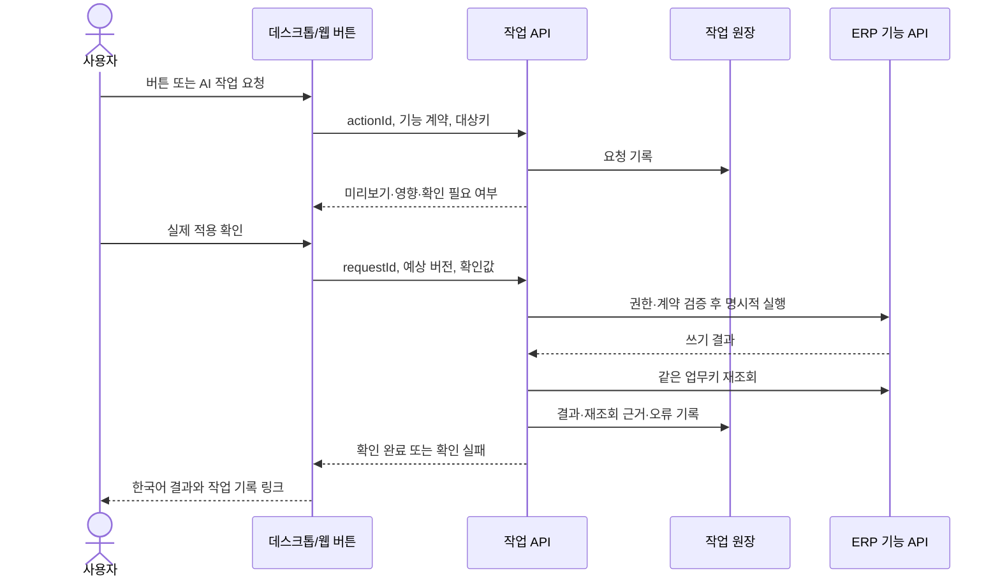

# 네노바 데스크톱 AI 작업·버튼 이력 설계

작성: 2026-11-03. 상태: 1단계 구현 중. 개인 업무 조회·추가·수정·삭제·복구 API와 계정별 작업 원장, 본인 버튼 기록 조회 화면을 구현했다. 다른 ERP 기능의 AI 도구는 아직 등록하지 않았다.

## 1단계 실제 API

- `GET /api/operations/capabilities`: 현재 계정에 등록된 개인 업무 도구 5개.
- `POST /api/operations/preview`: `{ "toolId":"personal-home.create", "origin":"ai", "input":{"date":"2026-11-03","title":"발주 확인"} }`. 쓰기 미리보기는 `operationId`, `expectedRevision`, 한국어 확인 문구를 반환하며 아직 저장하지 않는다. 조회 도구는 개인 업무 저장본을 읽고 즉시 `verified`가 된다.
- `POST /api/operations/{operationId}/confirm`: `{ "confirmed":true, "expectedRevision":0 }`. 사용자의 명시적 확인을 받은 호출자가 전송해야 한다. 서버는 인증 계정·기존 미리보기·버전을 확인하고 개인 업무 저장소의 중복 방지 `requestId`로 적용한다. 작업을 다시 조회해 `verified` 또는 `verification_failed`로 기록한다.
- `GET /api/operations/{operationId}`와 `GET /api/operations?offset=0&limit=50`: 해당 로그인 계정의 상태·결과·근거를 조회한다.
- `GET /api/operations/activity`: 현재 로그인 계정의 오늘 버튼·API 기록 최대 200건을 조회한다. `/work/operations`는 두 기록을 구별해서 보여준다. 버튼 조작만으로 저장 성공을 뜻하지 않는다.

현재 원장은 `data/runtime/operations`의 계정별 파일이며, 개인 업무 원장은 기존 `data/runtime/personal-home`에 남는다. 서버 운영 저장소의 영속성·백업은 배포 환경에서 확인해야 한다. API는 임의 SQL, 임의 HTTP, ECOUNT 변경을 제공하지 않는다.

## 사용자에게 보여줄 결과

앱의 **내 작업 기록**에서 사람이 한 버튼 조작과 AI가 처리한 작업을 시간순으로 본다. 한 줄에는 `누가 · 언제 · 어느 화면에서 · 무엇을 요청했는지 · 처리/확인 상태 · 결과`를 한국어로 표시한다. 행을 열면 원천 자료, 대상 연도·차수·업체·품목, 변경 전후, 제외·오류, 검증 근거, 다시 확인할 화면으로 이동한다. 조회, 미리보기, 실제 저장을 다른 단계로 표시한다. 저장하지 않은 미리보기를 성공한 ERP 변경으로 표시하지 않는다.

예: `11월 3일 16:20 · 김○○ · 2026년 45-01차 주문 · 수량 10단 추가 요청 → 저장 1건 → ViewOrder/Shipment 재조회 일치 · 확인 완료`. 개인 정보와 계좌번호는 목록에 표시하지 않는다.

## 현재 코드와 부족한 점

- `lib/userActivityClient.js`는 웹의 click/change/submit 및 같은 동작의 fetch/XHR을 `actionId`로 묶어 `/api/work/activity`에 전송한다. 입력값·요청 본문은 수집하지 않는다. 이 기록만으로 업무 저장 성공을 판단할 수 없다.
- `desktop/activity.cjs`는 탭·창·개인 업무 IPC의 이름과 경로를 암호화 대기열에 남긴다. 현재 결과가 `unknown`인 이벤트가 많고 대상 업무키·서버 재조회 결과가 없다.
- `desktop/home-workspace.cjs`와 `/api/desktop/home-workspace`는 제한된 명령, 인증 사용자 소유권, `requestId`, `expectedRevision`을 이미 사용한다. 이 방식은 작업 계약의 출발점으로 재사용할 수 있다.
- 일부 ERP 쓰기 API는 `lib/withActionLog.js`의 `SystemActionLog`를 사용한다. 이 테이블은 API마다 적용 여부가 다르므로 전 작업의 확인 원장으로 간주하지 않는다. 요청 본문 저장 경로는 민감정보 제한이 필요하다.

## 요청과 확인 흐름

AI는 등록된 기능 도구만 호출한다. 화면 DOM 클릭을 성공 근거로 쓰지 않으며, 데스크톱 shell에 임의 SQL·파일·HTTP 실행 권한을 주지 않는다. 읽기 전용 도구부터 등록하고, 각 쓰기 도구는 기존 ERP 계약과 dnSpy 근거, 대상 API 권한, 명시적 사용자 확인을 통과해야 한다. ECOUNT는 조회 전용이다.

## 공통 작업 계약

모든 버튼에는 안정적인 `actionType`과 한국어 `label`, 화면 경로를 지정한다. 범용 클릭 수집은 빠진 버튼을 찾는 보조 자료이고, 처리 결과는 서버의 기능별 API가 남긴다. 한 작업은 `actionId`로 버튼과 API를 연결하고 `requestId`로 재시도 중복 쓰기를 막는다. 서버가 인증한 `userId`만 실행 주체가 된다.

작업 원장 필드: `operationId`, `actionId`, `requestId`, `actorId`, `origin`(person/ai), `toolId`, `route`, `actionType`, `summaryKo`, `scope`(연도·전체 차수·업체·품목 등 기능별 업무키), `state`, `requestedAt`, `confirmedAt`, `finishedAt`, `resultCounts`, `beforeRef`, `afterRef`, `verification`, `errorCode`, `retryable`, `sourceRefs`. 요청 본문과 쿠키, 비밀번호, 계좌번호, 대화 원문은 원장에 저장하지 않는다. 필요한 수량·금액은 기능별 허용 필드와 접근 권한을 정한 뒤 저장한다.

상태는 `requested → previewed → awaiting_confirmation → running → applied → verifying → verified`를 기본으로 한다. 취소·거절·실패·검증 불일치는 별도 종료 상태다. `applied`에서 재조회가 실패하면 `verified`로 승격하지 않는다. 사용자가 확인한 시점과 서버가 실제 반영한 시점, 확인된 시점을 분리한다.

## API 경계

1. `GET /api/operations/capabilities`: 현재 로그인 계정에 허용된 도구, 읽기/쓰기, 확인 요구, 기능 계약 버전을 반환한다.
2. `POST /api/operations/preview`: 기능별 서버 어댑터가 대상과 예상 영향을 계산하고 `operationId`, 짧은 만료시간, 확인 문구를 반환한다. ERP 조회도 정확한 연도·차수 키로 제한한다.
3. `POST /api/operations/:id/confirm`: 예상 버전과 사용자의 명시 확인값을 재검증한다. 기능별 기존 API/트랜잭션을 호출하고 중복 `requestId`는 기존 결과를 반환한다.
4. `GET /api/operations/:id`: 처리 상태, 적용 수, 재조회 결과, 오류를 반환한다. 장시간 작업은 이 상태를 폴링하며 성공으로 추측하지 않는다.
5. `GET /api/operations?from=&to=&actor=&state=&actionType=`: 권한 범위의 작업 기록과 사람용 요약을 페이지 단위로 반환한다. CSV/Excel 내보내기는 동일 권한과 마스킹을 적용한다.

각 기능 어댑터는 입력 스키마, 권한, 업무키, preview/readback, 쓰기 부작용, 재시도 정책, 실패 복구 방법을 계약 파일로 고정한다. 특히 주문·출고·입고·재고·견적은 기존 `docs/contracts/*.json`과 테스트·dnSpy/DB 근거를 먼저 갖춰야 한다. 일반 버튼의 기록 실패는 화면에 `기록 전송 대기`로 드러내고, ERP 쓰기 결과 확인 실패는 작업을 `확인 실패`로 남긴다.

## 단계와 완료 기준

1. 현재 웹/PC 활동 기록에 `actionId` 연결률과 `unknown` 결과 건수를 측정한다. 버튼별 `actionType` 목록을 만든다. 데이터 입력값을 통째로 수집하지 않는다.
2. 읽기 전용 작업 1개와 개인 업무 생성·수정·삭제(복구 가능)를 공통 원장으로 연결해 사람용 작업 화면에서 요청·결과·재조회가 이어지는지 확인한다.
3. ERP 쓰기는 기능별로 계약과 회귀 테스트를 추가한 뒤 순차 연결한다. 연도·차수 교차 fixture, 미리보기/최종 적용 동일 범위, 중복 요청, 다른 계정, 실패 후 재조회, rollback을 검증한다.
4. 데스크톱과 일반 웹에서 같은 `operationId`를 열어 같은 결과를 본다. AI가 실행한 작업도 사용자 요청과 도구 실행, 승인, 검증 근거가 하나의 작업으로 연결되어야 한다.

전체 메뉴를 한 번에 자동 실행 가능으로 선언하지 않는다. `capabilities`에 없는 기능은 AI가 조회·처리 완료를 주장하지 않고 담당 화면을 연다. 기능별 완료 기준이 충족되면 목록을 확장한다.
